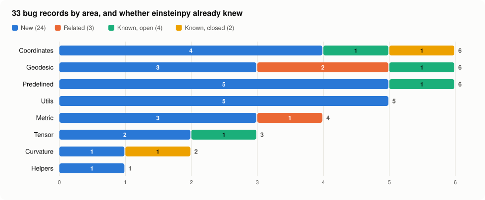

<h1 align="center">EinsteinPy Lean Check</h1>

<p align="center">einsteinpy, the Python library for general relativity, copied line by line into a proof assistant, raced against the real library 2.9 million times and checked against Physlib, the Lean library of physics. It found 33 bugs, and 24 of them had never been reported.</p>

<p align="center">
  
  
  
  
  
</p>

einsteinpy is an Astropy affiliated package for general relativity. This is what it says about the size of a black hole with the mass of the Sun:

```python
>>> import astropy.units as u
>>> from einsteinpy.metric import Schwarzschild
>>> # sph is any SphericalDifferential position
>>> Schwarzschild(coords=sph, M=1 * u.Msun).sch_rad
1.4852320538237331e-27
>>> Schwarzschild(coords=sph, M=1.989e30 * u.kg).sch_rad
2954.126555055405
```

The answer should be about 3 kilometres, as the second line shows. The first line gives 1.5e-27 metres, because the metric classes check that the mass has a unit of mass and then use the bare number as kilograms. One solar mass becomes one kilogram. Grams, percent spin and millicoulombs go wrong in the same way.

A few more of the 33, all from einsteinpy at commit `63e1c54`:

```python
>>> TransformationMatrix.from_new2old([x, y], [r, theta], [r*cos(theta), r*sin(theta)])
[[1/cos(theta), 1/sin(theta)], [-1/(r*sin(theta)), 1/(r*cos(theta))]]
>>> x = DualNumber(0.0, 1.0); (x * x) / x  # the function is x, so the derivative should be 1
DualNumber(0.0, 0.0)
```

The transformation matrix inverts each entry on its own instead of inverting the Jacobian, and einsteinpy's own test expects the wrong answer. The dual numbers used for automatic differentiation return a derivative of 0 for any quotient where both values are 0.

Two of the bugs change the physics of every orbit einsteinpy computes. `GeodesicIntegrator` with `order=6` or `order=8` converges at second order (measured orders 2.02 and 2.01 on a Schwarzschild orbit), because each level of its Yoshida composition uses the constants of the top level. The Kerr metric derivative has a plus sign where a minus belongs, so three Christoffel symbols of the Kerr metric are wrong by up to 6.5 percent and every Kerr geodesic is integrated with the wrong forces. Kerr-Newman has the correct sign, and einsteinpy's own test computes its expected value with the same faulty function, so it cannot see the difference.

## How it works, for people who have never used Lean

[Lean](https://lean-lang.org) is a programming language that is also a proof checker. You can write a function in it, run it like any other program, and then state a claim about every possible input, such as "this Lorentz transformation keeps the contraction of a vector with a covector the same". Lean only accepts the claim if you give it a proof that it checks step by step. If the claim is false, you prove that instead, by giving one input where it fails.

[Physlib](https://github.com/leanprover-community/physlib) is a community library of physics written in Lean, on top of the Mathlib library of mathematics. It defines objects such as the Lorentz group, the Minkowski metric and the solutions of the Friedmann equations. This project uses those definitions as the reference that einsteinpy is checked against.

The method has five steps.

<p align="center">
  <picture>
    <source media="(prefers-color-scheme: dark)" srcset="docs/images/pipeline-dark.svg">
    
  </picture>
</p>

1. **Read the Python.** Every model starts from the einsteinpy source at one pinned commit and cites the file and line it copies. The code it calls in sympy and NumPy counts as part of the code. For example, the model of `tensor_product` copies what `sympy.tensorcontraction` does with a negative axis, which is where one of the bugs comes from.
2. **Mirror it in Lean.** The Lean version keeps the same branches in the same order, with Python's rules for `None`, truthiness, negative indices and slices. Symbolic code is mirrored on exact rational numbers. Numerical code is mirrored on IEEE double precision numbers and compared bit for bit, with the results of `sin`, `cos`, `hypot` and similar functions passed in from the machine so that both sides use the same values.
3. **Race them.** A Python script makes 50,000 random inputs, biased toward awkward cases such as poles, horizons, zero spin, singular metrics and negative indices. It runs each input through the Lean model and through the real einsteinpy and compares the two answers as text. Every test has to agree on every input for three different random seeds. When they disagree, the model is wrong and gets fixed. The expected side is never edited.
4. **Prove with Physlib.** Each area has a second Lean layer that restates the formulas einsteinpy computes over the real numbers and compares them with Physlib's definitions and with the textbook identities. A proof there covers every input, where a test only covers the inputs that were tried.
5. **File the bug.** A claim that turns out false, and that the real einsteinpy also gets wrong, becomes a bug record with a script that reproduces it.

### One bug from start to finish

Here is the oldest bug in the list at each step. `BaseRelativityTensor.lorentz_transform` in `src/einsteinpy/symbolic/tensor.py` applies the transformation matrix to every index of a tensor.

```python
for i in range(self.order):
    if self.config[i] == "u":
        t = simplify(tensorcontraction(tensorproduct(tm, t), (1, 2 + i)))
    else:
        t = simplify(tensorcontraction(tensorproduct(tm, t), (0, 2 + i)))
```

An upper index is contracted with the second axis of the matrix, which gives `v' = Λ v`. A lower index is contracted with the first axis, which gives `w' = Λᵀ w`. The correct rule for a lower index uses the inverse, `w' = (Λ⁻¹)ᵀ w`. The two only agree for rotations.

The Lean model in `lean/EinsteinpyLean/Tensor/Model.lean` copies the loop, and the difftest checks it against einsteinpy on 150,000 random tensors and matrices. The specification in `lean/EinsteinpyLean/Tensor/Spec.lean` then states both rules over the real numbers and compares them with Physlib's `LorentzGroup`, the set of matrices with `Λᵀ η Λ = η`.

```lean
/-- PROP tensor.lorentz_transform.fixed_preserves_contraction : PROVEN -/
theorem fixed_preserves_contraction (Λ : LorentzGroup d) (v w : V d) :
    epUpper Λ.1 v ⬝ᵥ fixedLower Λ.1 w = v ⬝ᵥ w := by
  unfold epUpper fixedLower
  rw [mulVec_transpose, dotProduct_comm, ← dotProduct_mulVec, mulVec_mulVec,
    LorentzGroup.subtype_inv_mul, one_mulVec, dotProduct_comm]

/-- PROP tensor.lorentz_transform.main_preserves_contraction : REFUTED -/
theorem main_not_preserves_contraction :
    ¬ ∀ (Λ : LorentzGroup 1) (v w : V 1), epUpper Λ.1 v ⬝ᵥ epLower Λ.1 w = v ⬝ᵥ w
```

The first theorem says the corrected rule keeps `v^a w_a` unchanged for every Lorentz transformation in every dimension. The second says einsteinpy's rule does not, and proves it with the boost at three fifths of the speed of light, where `v^a w_a = 5` becomes `145/8`. Every covariant or mixed object in einsteinpy goes through this method, so the metric, Christoffel symbols, Riemann, Ricci, Einstein, Weyl, Schouten and stress-energy tensors are all transformed wrongly by a boost. The bug was reported in [einsteinpy#374](https://github.com/einsteinpy/einsteinpy/issues/374) and is fixed by the open pull request [einsteinpy#708](https://github.com/einsteinpy/einsteinpy/pull/708). The first theorem shows that the rule in that pull request is correct. The bug record is [bugs/tensor-lorentz-lower-index.yaml](bugs/tensor-lorentz-lower-index.yaml).

## What it found

<p align="center">
  <picture>
    <source media="(prefers-color-scheme: dark)" srcset="docs/images/findings-dark.svg">
    
  </picture>
</p>

There are 33 bug records. Four are high severity, which here means wrong physics on ordinary input. Eleven are medium and 18 are low. Every record has a reproducer that prints `REPRODUCED`, and all 33 do on einsteinpy at commit `63e1c54`.

On 24 and 25 November 2026 each record was searched for in the open and closed issues and pull requests of einsteinpy. The **Upstream** column gives the result.

- **New** means no issue or pull request describes the bug.
- **Related** means an existing report shares the cause or the code but does not describe this bug.
- **Known** means an open or closed issue or pull request already covers it.

### High severity

| What goes wrong | Area | Upstream | Record |
| --- | --- | --- | --- |
| `GeodesicIntegrator` with order 6 or 8 converges at order 2, because every level of the Yoshida triple jump uses the constants of the top level | Geodesic | **New** | [record](bugs/geodesic-fantasy-yoshida-order.yaml) |
| `Shadow` drops every ray, because `newton` returns the turning point with a tiny imaginary part and `np.isreal` rejects it | Geodesic | Related [einsteinpy#663](https://github.com/einsteinpy/einsteinpy/issues/663) | [record](bugs/geodesic-shadow-no-rays.yaml) |
| The Kerr metric derivative has the wrong sign in the r derivative of g_φφ, so three Christoffel symbols are wrong by up to 6.5 percent | Metric | Related [einsteinpy#523](https://github.com/einsteinpy/einsteinpy/issues/523) | [record](bugs/metric-kerr-dgdx-phiphi-sign.yaml) |
| `lorentz_transform` transforms lower indices with the matrix instead of its inverse | Tensor | Known, open [einsteinpy#374](https://github.com/einsteinpy/einsteinpy/issues/374) | [record](bugs/tensor-lorentz-lower-index.yaml) |

### Medium severity

| What goes wrong | Area | Upstream | Record |
| --- | --- | --- | --- |
| The Boyer-Lindquist velocity conversion raises `ZeroDivisionError` on the whole plane x = 0 | Coordinates | **New** | [record](bugs/coordinates-bl-velocity-x0.yaml) |
| `SchwarzschildEmbedding.gradient` has an extra factor of √R, so it depends on the unit of length, and einsteinpy's test expects the wrong value | Geodesic | **New** | [record](bugs/geodesic-embedding-gradient-factor.yaml) |
| `TransformationMatrix.from_new2old` and `inv()` invert each entry instead of the Jacobian, and einsteinpy's test expects the wrong value | Helpers | **New** | [record](bugs/helpers-transformation-matrix-reciprocal.yaml) |
| The Kerr-Newman contravariant potential and field tensor mix the coordinates t and c t, so their invariants are off by 1/c² and the field fails Maxwell's equations | Metric | **New** | [record](bugs/metric-em-contravariant-mixed-coordinates.yaml) |
| The metric classes check the unit of the mass but never convert it, so one solar mass is read as one kilogram | Metric | **New** | [record](bugs/metric-quantity-units-not-converted.yaml) |
| `tensor_product` with a negative index returns a tensor of the wrong rank with meaningless values instead of contracting or raising | Tensor | **New** | [record](bugs/tensor-product-negative-index.yaml) |
| A `DualNumber` quotient where both values are 0 returns derivative 0, so `x * x / x` at 0 has derivative 0 | Utils | **New** | [record](bugs/utils-dual-div-zero-over-zero.yaml) |
| `cartesian_to_bl` raises `ZeroDivisionError` on the ring singularity's disc and just above it, and loses digits near it | Coordinates | Known, closed [einsteinpy#500](https://github.com/einsteinpy/einsteinpy/issues/500) | [record](bugs/coordinates-bl-disc-crash.yaml) |
| `EinsteinTensor.from_metric` multiplies by the float 0.5, so exact symbolic results become inexact floats and an exact zero becomes -4.3e-19 | Curvature | Known, closed [einsteinpy#591](https://github.com/einsteinpy/einsteinpy/issues/591) | [record](bugs/curvature-einstein-float-half.yaml) |
| `RK4naive.direction` is always 0, so the solver steps past `t_bound` | Geodesic | Known, open [einsteinpy#711](https://github.com/einsteinpy/einsteinpy/issues/711) | [record](bugs/geodesic-rk4-direction.yaml) |
| `JanisNewmanWinicour` does not divide the angular part by c², so it does not reduce to Schwarzschild | Predefined | Known, open [einsteinpy#710](https://github.com/einsteinpy/einsteinpy/pull/710) | [record](bugs/predefined-jnw-angular-c.yaml) |

<details>
<summary><b>Low severity (18 records)</b></summary>

| What goes wrong | Area | Upstream | Record |
| --- | --- | --- | --- |
| The `CoordinateError` of `BoyerLindquistDifferential` prints a placeholder instead of the name of the coordinate system | Coordinates | **New** | [record](bugs/coordinates-bl-error-message.yaml) |
| `cartesian_to_bl` finds θ with `arccos` and returns exactly 0 near the axis where the spherical conversion gives 1e-9 | Coordinates | **New** | [record](bugs/coordinates-bl-theta-near-axis.yaml) |
| Velocities given next to a missing one are dropped without a warning | Coordinates | **New** | [record](bugs/coordinates-partial-velocities-dropped.yaml) |
| `StressEnergyMomentumTensor.change_config` returns an `EinsteinTensor` | Curvature | **New** | [record](bugs/curvature-stress-energy-change-config-class.yaml) |
| `Shadow._root_equation` truncates the mass with `int(mass)` while the rest of the class uses the mass itself | Geodesic | **New** | [record](bugs/geodesic-shadow-root-int-mass.yaml) |
| The `CoordinateError` messages of `singularities` lack a space and read "inBoyer-Lindquist" | Metric | **New** | [record](bugs/metric-singularities-message-space.yaml) |
| `BertottiKasner` has an undocumented unused parameter in front of `lambd`, so a positional call sets the wrong parameter | Predefined | **New** | [record](bugs/predefined-bertotti-kasner-unused-k.yaml) |
| `ReissnerNordstorm` and `BarriolaVilekin` are misspelled, so `find` does not find them by their real names | Predefined | **New** | [record](bugs/predefined-find-misspelled-names.yaml) |
| FLRW and Kerr-Newman-de Sitter use `real=True` symbols, so substituting a plain symbol silently does nothing | Predefined | **New** | [record](bugs/predefined-real-symbols.yaml) |
| The predefined metrics mix the signatures (-,+,+,+) and (+,-,-,-), so Minkowski and Schwarzschild with zero mass have opposite signs | Predefined | **New** | [record](bugs/predefined-signature-mismatch.yaml) |
| `SymbolicConstant("c")` overwrites the description of the module level constant `c` | Predefined | **New** | [record](bugs/predefined-symbolicconstant-overwrites.yaml) |
| `tensor_product(t1, t2, i=0)` silently skips the contraction because 0 is falsy, while `i=1` raises `TypeError` | Tensor | **New** | [record](bugs/tensor-product-zero-index-ignored.yaml) |
| `DualNumber` division raises `OverflowError` for divisors above about 1.3e154 although the quotient is finite | Utils | **New** | [record](bugs/utils-dual-div-overflow.yaml) |
| `DualNumber == 1` raises `AttributeError`, and `DualNumber` cannot be hashed | Utils | **New** | [record](bugs/utils-dual-eq-plain-number.yaml) |
| `_jacobian_g` returns inf on the diagonal when a derivative is above half the float range | Utils | **New** | [record](bugs/utils-dual-jacobian-diagonal-overflow.yaml) |
| `DualNumber(0, 1) ** 0` raises `ZeroDivisionError` | Utils | **New** | [record](bugs/utils-dual-pow-zero-at-zero.yaml) |
| `Geodesic` with `steps=0` raises an unrelated `IndexError` instead of returning an empty trajectory | Geodesic | Related [einsteinpy#673](https://github.com/einsteinpy/einsteinpy/pull/673) | [record](bugs/geodesic-steps-zero-indexerror.yaml) |
| `velocity(metric)` returns dt/dτ, a pure number, tagged as a speed in metres per second | Coordinates | Known, open [einsteinpy#528](https://github.com/einsteinpy/einsteinpy/issues/528) | [record](bugs/coordinates-velocity-meaning-and-units.yaml) |

</details>

The full list, kept in step with the YAML files by a script, is in [bugs/FINDINGS.md](bugs/FINDINGS.md).

### What Physlib checks

Each area's `Spec.lean` compares einsteinpy's formulas with Physlib's definitions and with the standard identities of general relativity. Some of these confirm that einsteinpy is right, and that is useful too, because the confirmed parts can be trusted.

- The rule for lower indices in [einsteinpy#708](https://github.com/einsteinpy/einsteinpy/pull/708) preserves contractions and commutes with lowering for every element of Physlib's `LorentzGroup`.
- The normalisation of the 4-momentum in [einsteinpy#690](https://github.com/einsteinpy/einsteinpy/pull/690) is correct for every symmetric metric. The formula on main is only correct when the metric has no time and space cross terms.
- einsteinpy's Minkowski metric is exactly minus Physlib's `minkowskiMatrix`, so the two use opposite signature conventions. Its Schwarzschild components agree with the exterior solution in PhyslibAlpha.
- The FLRW scale factors of einsteinpy for matter, radiation and a cosmological constant are Physlib's Einstein-de Sitter, radiation and de Sitter solutions, and each solves Physlib's Friedmann equations.
- The curvature code satisfies the textbook identities: Christoffel symbols are symmetric, Riemann is antisymmetric and satisfies the first Bianchi identity, Ricci is symmetric, the Einstein tensor has the right trace and the Weyl tensor is trace-free. All of them vanish for Physlib's Minkowski metric.
- The hand-coded Kerr Christoffel symbols drop no term, Kerr-Newman reduces to Kerr at zero charge and Kerr to Schwarzschild at zero spin, the horizons are the roots of Δ and the field tensor is the exterior derivative of the potential.
- Every coordinate round trip between Cartesian, spherical and Boyer-Lindquist coordinates is exact over the reals, and every velocity formula is the chain-rule derivative of its position map.
- The dual numbers form a commutative ring with ε² = 0, and their derivative part is Mathlib's derivative for every function einsteinpy implements.
- The Yoshida constants sum to one and satisfy the order condition only at the top level, the symplectic flows of the FANTASY integrator are symplectic, and the RK4 step satisfies the Butcher order conditions.
- The critical impact parameter of the Schwarzschild shadow is 3√3 M, reached exactly at r = 3M.

## What was modelled

The model covers all of einsteinpy except plotting: the symbolic tensor algebra, the curvature tensors, the 20 predefined metrics, the numerical metrics, the coordinate conversions, the geodesic integrators, the shadow and embedding code and the utilities. Higher order derivatives of the metric are not needed anywhere, because the curvature tensors are tested on metrics given by their value and first two derivatives at one point.

| Area | What it covers | Tests | Proved | Refuted | Bugs |
| --- | --- | --- | --- | --- | --- |
| Tensor | config checks, `_change_config`, `tensor_product` and `lorentz_transform` in `symbolic/tensor.py` | 1 | 6 | 4 | 3 |
| Helpers | `TransformationMatrix` in `symbolic/helpers.py` | 1 | 2 | 1 | 1 |
| Curvature | metric, Christoffel, Riemann, Ricci, Ricci scalar, Einstein, Weyl, Schouten, stress-energy and vector classes, every `from_*`, `change_config` and `lorentz_transform` | 3 | 13 | 2 | 2 |
| Predefined | all 20 predefined metrics, `find` and the symbolic constants | 3 | 16 | 6 | 6 |
| Utils | dual numbers and automatic differentiation, the FLRW scale factor, constants, bodies, units and exceptions | 2 | 54 | 5 | 5 |
| Coordinates | Cartesian, spherical and Boyer-Lindquist positions and velocities, the unit-checked classes, `velocity`, `v0` and the Lorentz factor | 3 | 15 | 9 | 6 |
| Metric | numerical Schwarzschild, Kerr and Kerr-Newman: components, derivatives, Christoffel symbols, the geodesic right-hand side, singularities and the electromagnetic potential and field | 3 | 19 | 5 | 4 |
| Geodesic | the FANTASY integrator at orders 2 to 8, RK4, the geodesic classes, `_P`, the shadow and the Schwarzschild embedding | 4 | 48 | 15 | 6 |
| **Total** | | **20** | **173** | **47** | **33** |

In numbers, the Lean side is about 9,300 lines, of which about 2,900 are the Physlib and Mathlib specification. The Python test side is about 4,100 lines. The 20 differential tests run 2.9 million cases in all, and every one agrees with einsteinpy. Nineteen tests run 50,000 cases on each of three seeds. The test of the full curvature chain runs 5,000 per seed, because sympy needs about 0.3 seconds to simplify each case. There are 220 claims, and Lean has checked a proof or a counterexample for each of them. No proof is left unfinished and no new axiom is assumed. The tactic `native_decide`, which checks a claim by running compiled code, appears 86 times, always to evaluate the model on one concrete input, and each use says so in a comment.

Everything was run on einsteinpy at commit `63e1c54537a385c9f56d7d4075b0261ddaa96069` (version 0.6.dev0) with sympy 1.14.0 and NumPy 2.5.5 on an Apple silicon Mac, with Lean 4.36.0 and Physlib at commit `cbd02238fd1414edd9fa34871acc2a0fcdc20c21`. The bit-exact tests of numerical code depend on this machine's libm and BLAS, and the test files say where.

## Run it yourself

You need [elan](https://github.com/leanprover/elan), which installs the pinned Lean version by itself, and Python 3.

```bash
scripts/fetch_einsteinpy.sh
```

```bash
scripts/fetch_cache.sh
```

```bash
cd lean && lake build && cd ..
```

```bash
.venv/bin/python difftest/tensor_index_diff.py --cases 50000 --seed 0
```

```bash
.venv/bin/python scripts/check_props.py
```

```bash
.venv/bin/python scripts/check_bugs.py
```

The first command clones einsteinpy at the pinned commit into `vendor/einsteinpy`, so that the line numbers in the models can be read, and installs it into `.venv`. The second downloads the prebuilt Mathlib and Physlib files, so that nothing large has to be compiled. The third builds the Lean models, checks every proof and builds the test executables. The fourth races the Tensor model against einsteinpy. `check_props.py` counts the claims by area and fails if any proof is unfinished. `check_bugs.py` runs every reproducer and fails if one stops reproducing, which is also how you notice when einsteinpy fixes something.

## Repository layout

| Path | Contents |
| --- | --- |
| `lean/EinsteinpyLean/<Area>/Model.lean` | The mirrored einsteinpy code in core Lean, with a source line cited for each function |
| `lean/EinsteinpyLean/<Area>/Props.lean` | Claims about the model, each proved or refuted, with a status line that `check_props.py` counts |
| `lean/EinsteinpyLean/<Area>/Spec.lean` | The formulas over the real numbers, checked against Physlib and Mathlib |
| `lean/EinsteinpyLean/<Area>/Diff.lean` | The handlers that let the test scripts call the model |
| `lean/EinsteinpyLean/Common/` | The mirror of `sympy.Array` and the shared test protocol |
| `difftest/` | The differential tests and the shared harness |
| `bugs/` | One YAML record per bug, `FINDINGS.md`, and a reproducer for each in `bugs/repro/` |
| `scripts/` | Fetching einsteinpy and the caches, counting claims, rerunning reproducers and drawing the figures |
| `docs/MODELLING.md` | The rules for modelling a new area, for anyone who wants to add one |

## Prior work

The method follows [python-formalization](https://github.com/Broyojo/python-formalization), which models CPython in Lean and tests the model against the real interpreter, [julia-in-lean](https://github.com/MilesCranmer/julia-in-lean), which does the same for Julia, and [NumPy Lean Check](https://github.com/pragyaangaur/NumPy-Lean-Check), which applied it to NumPy. This project adds a physics library as the reference. As far as a search in November 2026 could tell, nobody had formally modelled or differentially tested einsteinpy before. [LeviPy](https://pypi.org/project/levipy/) is a separate SymPy package for general relativity that can export proof obligations to Lean.

None of these bugs has been reported to einsteinpy from this project. Two of the known records are fixed by open pull requests from the author of this repository, [einsteinpy#708](https://github.com/einsteinpy/einsteinpy/pull/708) and [einsteinpy#710](https://github.com/einsteinpy/einsteinpy/pull/710), and the `_P` result above concerns a third, [einsteinpy#690](https://github.com/einsteinpy/einsteinpy/pull/690). Anyone who wants to report one of the others should read einsteinpy's contributing guidelines first and write the report in their own words.

## Licence

The code, models, tests and bug records in this repository are under the MIT licence in [LICENSE](LICENSE). einsteinpy is a separate project under its own MIT licence, and `scripts/fetch_einsteinpy.sh` downloads it rather than copying it here. Physlib and Mathlib are under the Apache 2.0 licence and are fetched by Lake. The Python excerpts quoted in this README and in the model comments come from einsteinpy.
